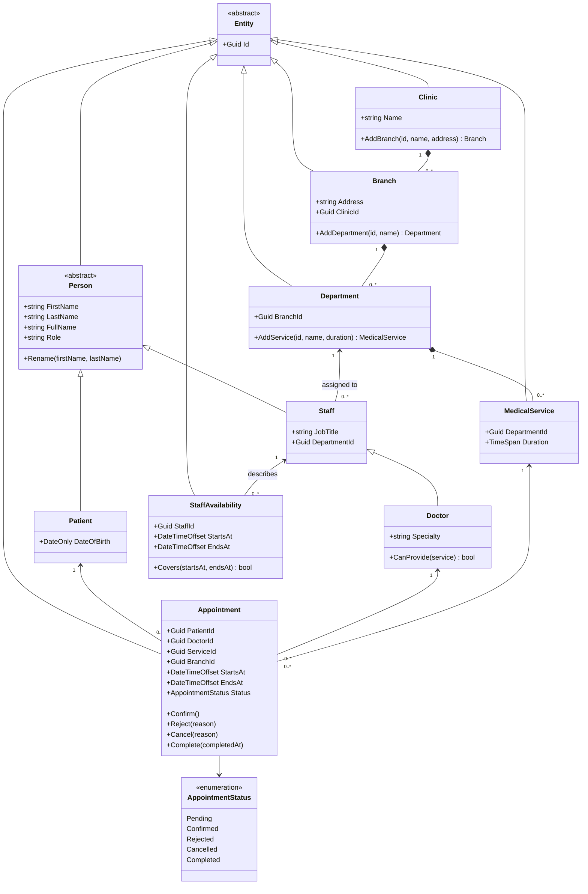

# Initial domain model

The Domain project targets .NET 8 and depends only on the base class library. It has no EF Core, Identity, MVC, or persistence dependencies. Existing Application, Infrastructure, Web, and scaffold tests remain intact.

## Classes and relationships

| Class | Responsibility |
| --- | --- |
| Entity | Abstract identity base; requires a non-empty immutable Guid. |
| Person | Abstract person with validated names, derived FullName, atomic Rename, and abstract Role. |
| Patient | Person with an immutable birth date that cannot be later than the UTC date at construction. |
| Staff | Person assigned to one immutable Department and a required job title. Concrete for non-doctor staff. |
| Doctor | Specialized Staff with a required specialty and CanProvide(service), based on matching department identifiers. |
| Clinic | Owns branches; AddBranch validates input and rejects duplicate child identifiers. |
| Branch | Belongs to a Clinic, has a required address, and owns departments. |
| Department | Belongs to a Branch and owns its medical service catalog. |
| MedicalService | Belongs to a Department; has a required name and a positive immutable duration. |
| StaffAvailability | A staff member's immutable interval; Covers checks whether a valid interval fits inside it. |
| Appointment | Associates a Patient, Doctor, and MedicalService at a fixed time and guards status transitions. |

Every entity receives its Guid from the caller. Parent/participant references are immutable, and corresponding identifier properties are derived from those references. Identifiers represent logical identity; objects retain normal reference equality. Global identifier uniqueness belongs to a future application/persistence boundary. Duplicate child identifiers are checked within each owner's collection.

Clinic.AddBranch, Branch.AddDepartment, and Department.AddService are the only public creation paths for their children. This keeps both sides of ownership consistent. Read-only collection wrappers prevent callers from adding/removing children directly. Invalid additions leave collections unchanged. Names and required text are trimmed. Invalid arguments raise ArgumentException (or its null/out-of-range subclasses); invalid lifecycle operations raise InvalidOperationException.

## OOP principles

- **Encapsulation:** there are no public setters. Names change together through Rename; appointment status changes only through named methods. Identifiers and associations cannot be reassigned.
- **Inheritance:** Patient and Staff inherit Person; Doctor inherits Staff. Common identity and name behavior are implemented once.
- **Abstraction:** abstract Entity and Person capture common contracts without allowing incomplete base instances. Person.Role describes a person's domain role, not an authentication claim or permission.
- **Polymorphism:** callers can process Patient, Staff, and Doctor through Person references. Role dispatches to each subtype: Patient, the staff job title, or Doctor. Tests demonstrate dispatch and Doctor's substitutability as Staff.
- **Composition:** clinics contain branches, branches contain departments, and departments contain services. These owned children are created by their parent and exposed through read-only views. Appointment and StaffAvailability instead associate independently existing people and services.

## Appointment lifecycle and time rules

New appointments start Pending. Doctor and service must have the same department identifier; the branch is derived from that department. End time is calculated from the service duration at creation. DateTimeOffset comparisons use absolute instants, including when offsets differ. Unsupported end-time overflow is rejected by DateTimeOffset.

| Current status | Operation | Result |
| --- | --- | --- |
| Pending | Confirm() | Confirmed |
| Pending | Reject(reason) | Rejected |
| Pending | Cancel(reason) | Cancelled |
| Confirmed | Cancel(reason) | Cancelled |
| Confirmed | Complete(completedAt) | Completed, only at/after EndsAt |

Rejected, Cancelled, and Completed are terminal. Repeating an operation or taking any unlisted transition throws without mutating state. Reject and Cancel require a nonblank reason, retained as DecisionReason. Complete accepts an explicit time so lifecycle tests do not depend on the wall clock; the future application layer must supply a trusted time.

Availability intervals require end > start. Covers accepts positive intervals and includes exact matching start/end boundaries. Availability is descriptive: appointments do not yet reserve availability, check overlaps, require future dates, or allocate slots. Doctor specialty is descriptive; eligibility currently uses department membership only. No transfer/removal policies, authorization rules, booking quotas, audit history, global uniqueness, or concurrency guarantees are implemented.

These are Domain-layer boundaries. Milestone 5 implements future-time/availability checks, scoped authorization and SQLite overlap protection in the application/persistence boundary while preserving this domain model; see [appointment booking design](appointment-booking-design.md).

## Class diagram



## Validation

The xUnit suite covers inheritance/polymorphism, name validation and atomic rename, identity and relationship guards, read-only ownership, duplicate child IDs, positive durations, time-window boundaries, all 20 status/action combinations, required decision reasons, and completion timing. The original scaffold boundary test continues to check that Domain does not reference ASP.NET Core, EF Core, or outer layers.

Run from the repository root:

```sh
dotnet build MediClinic.sln
dotnet test MediClinic.sln --no-build
```
