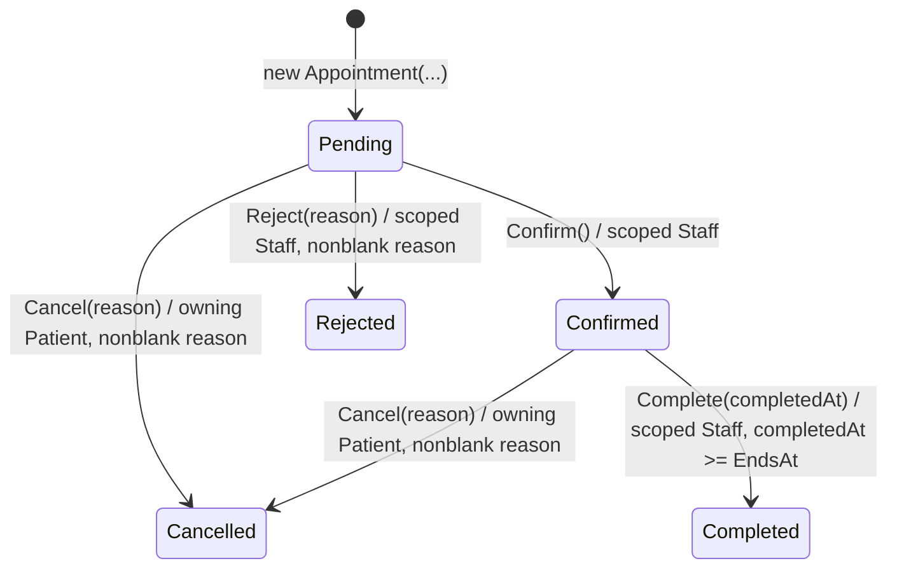

# Appointment lifecycle

Source: [Appointment](../../src/MediClinic.Domain/Appointment.cs), [AppointmentBooking.Act](../../src/MediClinic.Infrastructure/AppointmentBooking.cs), and the patient/staff controller POST actions.

Rejected, Cancelled and Completed have no outgoing domain transitions. There is no automatic timeout, deletion, reopening or rescheduling transition. New bookings start Pending. Domain methods enforce status/reason/time rules; service and MVC enforce the actor's role and ownership/department scope. Cancel does not enforce a future-start cutoff: Pending/Confirmed appointments remain cancellable even after their start. Confirm/Reject do not have a scheduled-start cutoff either. Complete uses the service's current UTC clock; equality with EndsAt is permitted. Pending, Confirmed and Completed block overlapping doctor intervals; Cancelled and Rejected release them.
