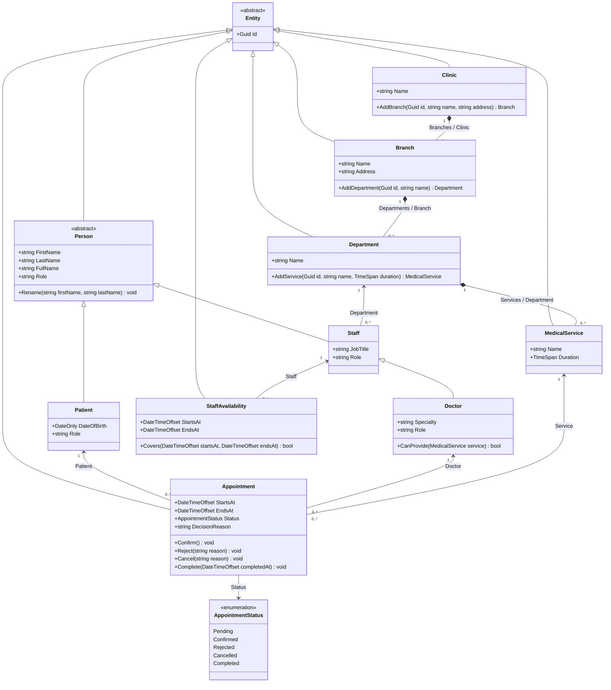

# Domain class diagram

Source: [Domain](../../src/MediClinic.Domain). Selected public members are shown; all concrete domain entities inherit Entity, directly or through Person/Staff. Multiplicities describe the object model; database deletion uses Restrict rather than cascading deletion. Guard is an internal validation helper, not an entity.

`DecisionReason` is nullable. Appointment.Branch is derived from Service.Department.Branch, not an independent editable association. Navigation ID properties derive from the referenced entity; EF uses shadow foreign keys for these relationships. Read-only parent collections are not arbitrary public setters.
