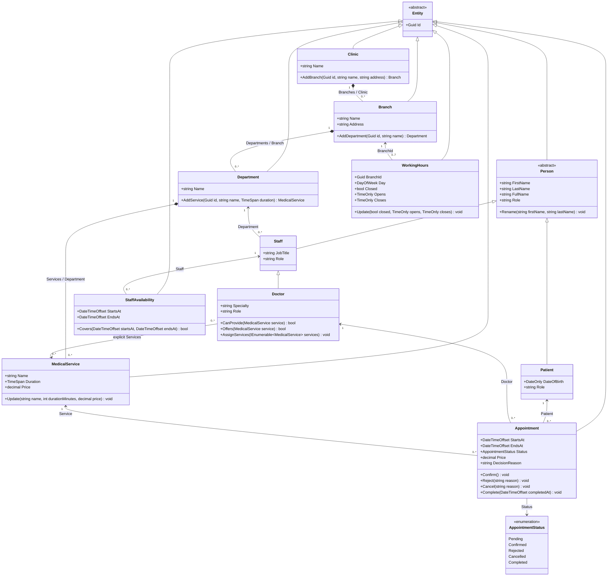

# Domain class diagram

Source: [Domain](../../src/MediClinic.Domain). Selected public members are shown; all concrete domain entities inherit Entity, directly or through Person/Staff. Multiplicities describe the object model; database deletion uses Restrict rather than cascading deletion. Guard is an internal validation helper, not an entity.

`DecisionReason`, appointment `Price`, and working-hours `Opens`/`Closes` are nullable. Appointment Price and StartsAt/EndsAt retain booking-time price/duration; NULL price is unknown legacy data. Appointment.Branch derives from Service.Department.Branch. WorkingHours associates by BranchId, with a unique branch/day pair; missing weekdays are unrestricted. DoctorServices persists the explicit many-to-many assignment. ClinicAdministrator is an Infrastructure authorization record; see [architecture](layered-architecture.md). Navigation IDs otherwise derive from referenced entities; EF uses shadow FKs for those relationships. Read-only collections protect mutation.
