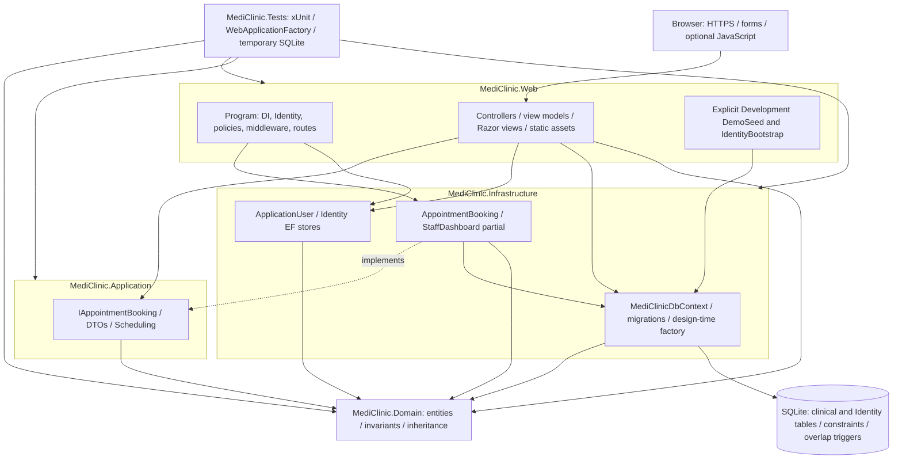

# Layered architecture

Source: project references in [Web](../../src/MediClinic.Web/MediClinic.Web.csproj), [Application](../../src/MediClinic.Application/MediClinic.Application.csproj), [Infrastructure](../../src/MediClinic.Infrastructure/MediClinic.Infrastructure.csproj), [Domain](../../src/MediClinic.Domain/MediClinic.Domain.csproj), and the [composition root](../../src/MediClinic.Web/Program.cs).

Arrows indicate use/dependency; the dashed arrow indicates interface implementation. This is a layered solution with pragmatic outer-layer coupling: AccountController directly uses Identity and DbContext for transactional registration, and Web references Infrastructure for composition and development tooling. It is not a claim of strict Clean Architecture. Application's AddApplication currently adds no concrete use-case service; AddInfrastructure registers IAppointmentBooking, DbContext and TimeProvider.System. Domain has no framework or outer-layer dependencies. SQLite contains a People TPH hierarchy and separate catalog/appointment/Identity tables. Startup never applies migrations or seeds automatically.
