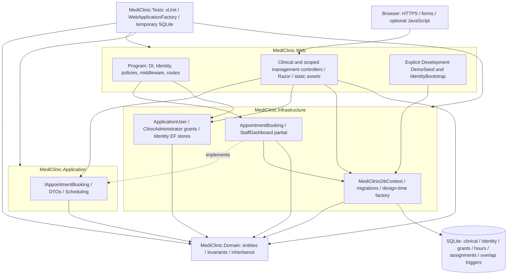

# Layered architecture

Source: project references in [Web](../../src/MediClinic.Web/MediClinic.Web.csproj), [Application](../../src/MediClinic.Application/MediClinic.Application.csproj), [Infrastructure](../../src/MediClinic.Infrastructure/MediClinic.Infrastructure.csproj), [Domain](../../src/MediClinic.Domain/MediClinic.Domain.csproj), and the [composition root](../../src/MediClinic.Web/Program.cs).

Arrows indicate dependencies; the dashed arrow indicates interface implementation. AccountController uses Identity and DbContext for registration; ClinicManagementController and EmployeeManagementController perform scoped transactions directly through DbContext. This is pragmatic layering, not strict Clean Architecture. AddInfrastructure registers IAppointmentBooking, DbContext and TimeProvider.System. Domain has no framework dependencies. SQLite maps Person as People TPH and stores separate catalog, appointment, Identity, WorkingHours, DoctorServices and ClinicAdministrators tables. Six migrations reach M12. Startup never migrates or seeds automatically. The external [Python operator tool](../../tools/database-safety.py) provides read-only inspection, online backup and explicit verified grants; it is not a runtime dependency or web privilege API.
