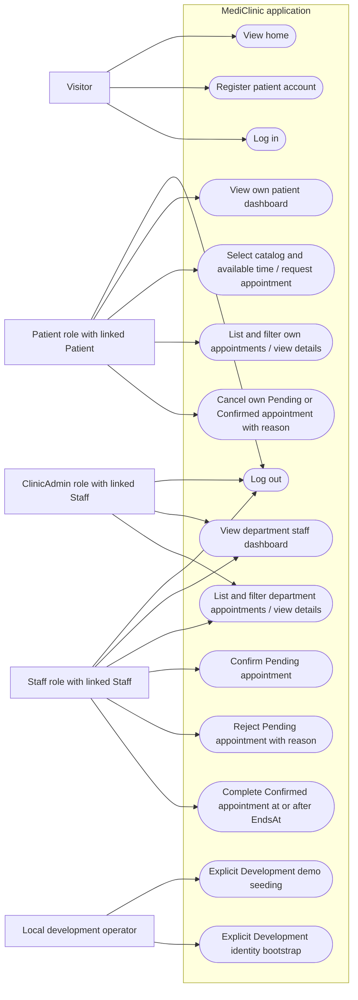

# Actors and use cases

Mermaid flowchart equivalent of a use-case diagram. Source: [controllers](../../src/MediClinic.Web/Controllers), [policies](../../src/MediClinic.Web/Program.cs), and [service scope checks](../../src/MediClinic.Infrastructure/AppointmentBooking.cs).

All roles log in through the same account endpoint. ClinicAdmin alone has read access only, restricted to its linked Staff department; an unlinked administrator cannot load clinical dashboard/list data. Review mutations additionally require the Staff role. Bootstrap creates an unlinked ClinicAdmin; it does not grant global clinical access. Doctor is a domain subtype, not an additional Identity role. There is no catalog-management, availability-management or account-relinking web use case.
