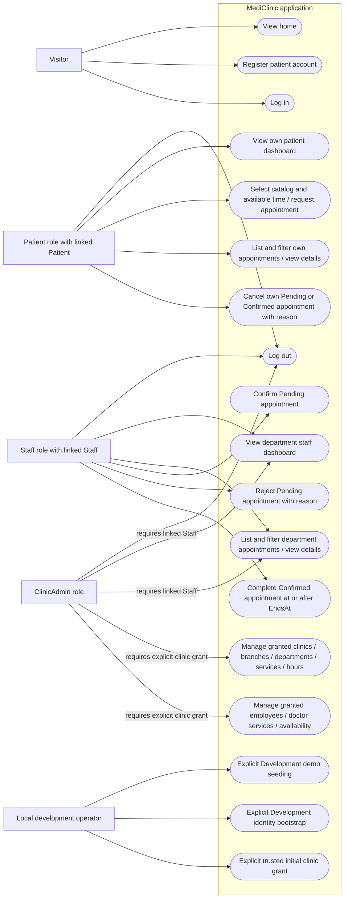

# Actors and use cases

Mermaid flowchart equivalent of a use-case diagram. Source: [controllers](../../src/MediClinic.Web/Controllers), [policies](../../src/MediClinic.Web/Program.cs), and [service scope checks](../../src/MediClinic.Infrastructure/AppointmentBooking.cs).

All roles share the login endpoint. Clinical reads for ClinicAdmin require a Staff link and remain department-scoped; review mutations additionally require Staff role. Catalog/employee management instead requires explicit clinic grants. Bootstrap creates an unlinked ClinicAdmin without grants; [trusted provisioning](../database-migration-runbook.md#initial-administrator-provisioning) is separate. Doctor uses Staff Identity role. No public privileged registration, account-relinking or grant-management web use case exists.
